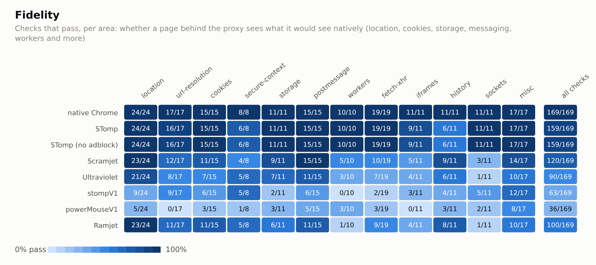
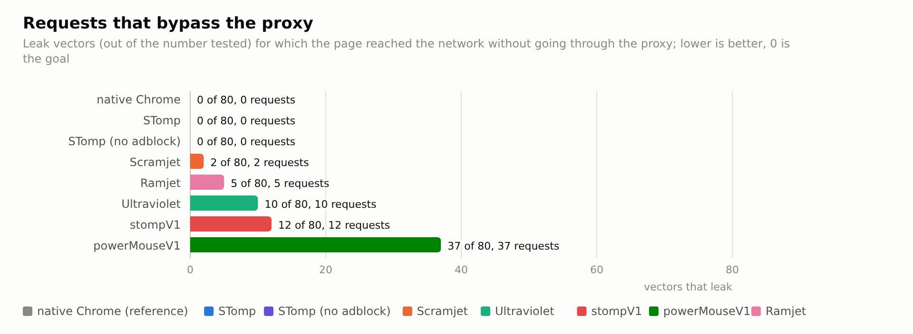
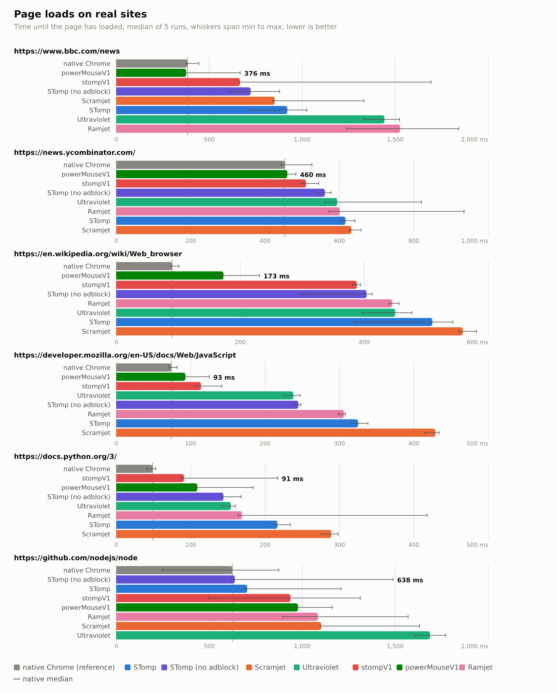
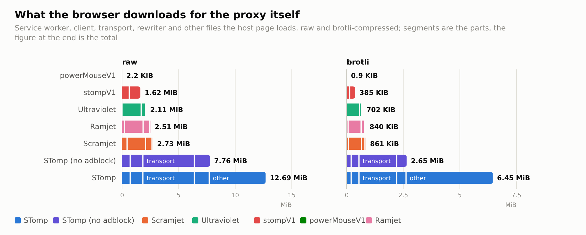

# @sysce/stomp

<div align="center">
  <a href="https://www.npmjs.com/package/@sysce/stomp"></a>
  <a href="https://github.com/Fracital/powerMouse/issues"></a>
  <a href="https://github.com/Fracital/powerMouse/wiki"></a>
  <a href="https://github.com/Fracital/powerMouse/stargazers"></a>
</div>

Powered by [holyWisp](https://github.com/Fracital/holyWisp): the live demo at
https://stomp.fracit.al tunnels its traffic through holyWisp, the wisp relay
behind the public `wss://holywisp.fracit.al/`.

A rewrite of the STomp proxy.

Original implementation of https://github.com/tomphttp/specifications.

STomp rewrites HTML, CSS and JavaScript inside a service worker and tunnels the
actual HTTP and WebSocket traffic through a
[proxy-transports](https://github.com/MercuryWorkshop/proxy-transports)
transport (for example [epoxy](https://github.com/MercuryWorkshop/EpoxyTransport)
or [libcurl](https://github.com/MercuryWorkshop/CurlTransport)) that lives in
the page that owns the proxy. Proxied content is shown in frames.

## Documentation

The [wiki](https://github.com/Fracital/powerMouse/wiki) explains how to use
STomp and embed it in your own site:

- [Quickstart](https://github.com/Fracital/powerMouse/wiki/Bootstrapper-quickstart):
  the demo, then the smallest host page
- [Install into an existing app](https://github.com/Fracital/powerMouse/wiki/Install-into-an-existing-app):
  serving `dist/`, the service worker, a wisp relay and a transport
- [Embed STomp in your site](https://github.com/Fracital/powerMouse/wiki/Embed-STomp-in-your-site):
  tabs, an address bar, history, popups and error pages
- [Origin isolation](https://github.com/Fracital/powerMouse/wiki/Origin-isolation)
  and [Deploy STomp](https://github.com/Fracital/powerMouse/wiki/Deploy-STomp)
  for production
- [Configure STomp](https://github.com/Fracital/powerMouse/wiki/Configure-STomp):
  every option, method and event
- [Transports and Wisp](https://github.com/Fracital/powerMouse/wiki/Transports-and-Wisp)
  and [Troubleshooting](https://github.com/Fracital/powerMouse/wiki/Troubleshooting)

The sections below are the reference for this commit.

## Usage

Serve `dist/` (its path is exported from `@sysce/stomp/path` as `stompPath`)
from a directory of your site, register the service worker from that directory
(`register()` uses it as the scope and resolves once the worker is activated),
and hand the registration to a controller together with a transport:

```js
import EpoxyTransport from '@mercuryworkshop/epoxy-transport';
import { StompController } from '@sysce/stomp';

const registration = await StompController.register('/stomp/');

const controller = new StompController({
	serviceworker: registration,
	transport: new EpoxyTransport({ wisp: 'wss://example.com/wisp/' }),
	directory: '/stomp/',
	codec: 'xor',
});

await controller.wait();

const frame = controller.createFrame(document.querySelector('iframe'));
await frame.go('https://example.com');
```

`dist/Controller.js` and `dist/SearchBuilder.js` expose the same API as classic
scripts through the `StompController` and `SearchBuilder` globals.
`dist/omnibox.js` is the address bar dropdown (below) as the classic script
global `Omnibox`, and `@sysce/stomp/omnibox` (`dist/omnibox.mjs`) is the same
module for a bundler.

Any `ProxyTransport` works. Use epoxy, from the build this repository pins
(see "Embedding"): HTTP and WebSocket frames both flow as they do natively
there. libcurl-transport 2.0.6 handles WebSockets but stopped answering HTTP
after about 70 requests in testing against `wisp-js` 0.5.2; see the
changelog's known limitations before picking it.

## API

`StompController` (also `window.StompController` from `dist/Controller.js`):

| Member                                                                             | Description                                                                                                                                                                                                                                                                                                                                                                                                                                                                                                                                                                                                                                                                                                                                                                                                                                                                                                                                                                                                                                                                                                                                                                                                                                                                                                                                                                                                                                                                                                                                                                                                                                                                                                                           |
| ---------------------------------------------------------------------------------- | ------------------------------------------------------------------------------------------------------------------------------------------------------------------------------------------------------------------------------------------------------------------------------------------------------------------------------------------------------------------------------------------------------------------------------------------------------------------------------------------------------------------------------------------------------------------------------------------------------------------------------------------------------------------------------------------------------------------------------------------------------------------------------------------------------------------------------------------------------------------------------------------------------------------------------------------------------------------------------------------------------------------------------------------------------------------------------------------------------------------------------------------------------------------------------------------------------------------------------------------------------------------------------------------------------------------------------------------------------------------------------------------------------------------------------------------------------------------------------------------------------------------------------------------------------------------------------------------------------------------------------------------------------------------------------------------------------------------------------------- |
| `StompController.register(directory?, { assets, updateViaCache })`                 | static: registers the service worker served from `directory` (`assets.serviceWorker` names the file) with that scope and `updateViaCache: 'none'` (overridable), resolves with the registration once its worker is activated, 30 s at the most; a worker stuck installing never hangs the host. Pass `directory`: left out, it is the directory of the script that calls `register()` (`document.currentScript`), which for an inline or module script is the page's, so a page at `/` that loads `/stomp/Controller.js` and calls `register()` from its own script asks for `/serviceWorker.js`. A browser without service workers (or a page that is not a secure context) gets an `Error`                                                                                                                                                                                                                                                                                                                                                                                                                                                                                                                                                                                                                                                                                                                                                                                                                                                                                                                                                                                                                                          |
| `StompController.DEFAULT_ASSETS`                                                   | static: the dist file names `init.assets` falls back to (`serviceWorker: 'serviceWorker.js'` and the rest), for a host that registers or links a file itself and takes its name from one place                                                                                                                                                                                                                                                                                                                                                                                                                                                                                                                                                                                                                                                                                                                                                                                                                                                                                                                                                                                                                                                                                                                                                                                                                                                                                                                                                                                                                                                                                                                                        |
| `new StompController(init)`                                                        | `init.serviceworker` (a `ServiceWorker`, or a `ServiceWorkerRegistration` whose active, waiting or installing worker is taken and the handshake made once it is activated), `init.transport` (an instance or a descriptor, next row), optional `codec`, `directory` (the same default as `register()`, so pass it to both; a directory on another origin is an `Error`)                                                                                                                                                                                                                                                                                                                                                                                                                                                                                                                                                                                                                                                                                                                                                                                                                                                                                                                                                                                                                                                                                                                                                                                                                                                                                                                                                               |
| `init.transport`                                                                   | a `ProxyTransport` instance (served from this page) or a `TransportDescriptor` `{ module, options, host? }`: the controller imports and constructs it in a dedicated Worker (`transportWorker.js` from `directory`), off the page's thread, so a proxied frame's synchronous XHR that needs the network completes; `host: 'page'` imports it in the page instead. The module is an ES module importable in a worker whose default export is a ProxyTransport class (epoxy and libcurl qualify)                                                                                                                                                                                                                                                                                                                                                                                                                                                                                                                                                                                                                                                                                                                                                                                                                                                                                                                                                                                                                                                                                                                                                                                                                                        |
| `init.transport.http3`                                                             | optional, off by default: HTTP/3 over QUIC for origins that offer it (`Alt-Svc`, an HTTPS DNS record with `dns`, or `force`), carried by the transport's wisp UDP streams; `true` or `{ force, dns, timeout, wait, module, pem }` (`dns` defaults to epoxy's `ech_dns`). Needs epoxy (`client.connect_udp`) and a wisp server that relays UDP; until a handshake has worked, requests go over the transport as before, and a failure falls back with no wait. Works in `RemoteController` descriptors too. See docs/http3.md                                                                                                                                                                                                                                                                                                                                                                                                                                                                                                                                                                                                                                                                                                                                                                                                                                                                                                                                                                                                                                                                                                                                                                                                          |
| `init.transport.webTransport`                                                      | optional, off by default: Wisp over the relay's WebTransport session in place of its WebSocket, when the relay has one (holyWisp's listener): a `wss:` wisp URL dialed as `https:`, or what `/webtransport.json` on its origin names; `true` or `{ url, discovery, timeoutMs, lanes }` (`timeoutMs` 2000). A relay not met before gets the session and the WebSocket at once, and the session is ridden when it is up within one and a half `timeoutMs`; what happened is kept per relay. Epoxy only. `carrier` says which one the connection rides. See docs/webtransport.md                                                                                                                                                                                                                                                                                                                                                                                                                                                                                                                                                                                                                                                                                                                                                                                                                                                                                                                                                                                                                                                                                                                                                         |
| `init.transport.shards`                                                            | optional: how many threads the transport's TLS may run on (`host: 'worker'`, epoxy given a `wisp` URL). The transport worker runs the module itself, and starts more instances in workers of its own only when it cannot keep up with downloads from more servers than it has threads; each origin's connections run on one of them, over the one wisp connection (one session or WebSocket to the relay; with the carrier host, each worker a rider of its own), the transport worker takes no new origin while a worker runs, and a worker that carried nothing for 30 s closes. The socket pool, the fields sent and the order requests go in stay the transport worker's. A number is the most threads, the transport worker's counted (`1`: it alone, as before); `{ max, start }` also starts `start` of them at once. Default: workers for half the cores the browser reports, at most 4, beside the transport worker's own thread; none from the start                                                                                                                                                                                                                                                                                                                                                                                                                                                                                                                                                                                                                                                                                                                                                                        |
| `transportHost`                                                                    | `worker` or `page`: where the transport runs; `page` for an instance, `host: 'page'`, or after the worker fell back                                                                                                                                                                                                                                                                                                                                                                                                                                                                                                                                                                                                                                                                                                                                                                                                                                                                                                                                                                                                                                                                                                                                                                                                                                                                                                                                                                                                                                                                                                                                                                                                                   |
| `transporthost` event                                                              | `detail: { host: 'page', error }`: the worker could not start or could not import the module, so the page imported it instead (when that fails too, requests fail at once until `setTransport()`)                                                                                                                                                                                                                                                                                                                                                                                                                                                                                                                                                                                                                                                                                                                                                                                                                                                                                                                                                                                                                                                                                                                                                                                                                                                                                                                                                                                                                                                                                                                                     |
| `init.debugTransport`                                                              | the transport's verbose log on the host's console: a `[net]` line for each connection the transport opens and what it rides (HTTP/1.1, HTTP/2, HTTP/3, WebTransport or the WebSocket), and each HTTP/3 fallback with its reason. Off unless set, or unless `localStorage['stomp:debug-transport']` is `'1'` on the host's origin; the `[wisp]` lines (what the wisp connection rides) are printed either way                                                                                                                                                                                                                                                                                                                                                                                                                                                                                                                                                                                                                                                                                                                                                                                                                                                                                                                                                                                                                                                                                                                                                                                                                                                                                                                          |
| `init.carrierHost`                                                                 | on unless `false`: a transport given a wisp URL rides one wisp connection per origin, kept in a SharedWorker of the transport worker's script, so a reload or a second tab opens no new session or WebSocket to the relay. `false` has each transport open its own. `StompController` only                                                                                                                                                                                                                                                                                                                                                                                                                                                                                                                                                                                                                                                                                                                                                                                                                                                                                                                                                                                                                                                                                                                                                                                                                                                                                                                                                                                                                                            |
| `carrier`, `carrier` event                                                         | what the transport's wisp connection rides, once known (`{ carrier, url, ms, why?, ... }`, `carrier` is `webtransport` or `websocket`; `why: 'off'` without `webTransport`); the event fires each time it connects or reconnects. Null for an instance or a transport given no wisp URL                                                                                                                                                                                                                                                                                                                                                                                                                                                                                                                                                                                                                                                                                                                                                                                                                                                                                                                                                                                                                                                                                                                                                                                                                                                                                                                                                                                                                                               |
| `init.allowInvalidJs`                                                              | a script the rewriter cannot parse runs as it was (default); `false` makes it fail with a `SyntaxError` naming the rewriter error, so a broken rewrite is loud                                                                                                                                                                                                                                                                                                                                                                                                                                                                                                                                                                                                                                                                                                                                                                                                                                                                                                                                                                                                                                                                                                                                                                                                                                                                                                                                                                                                                                                                                                                                                                        |
| `init.membrane`                                                                    | the window membrane, on unless `false`: every window and every object of another window's realm reaches a page through a proxy that checks on each use which site the window shows now, and acts as the browser's cross-origin window when it is another proxied site. `false` turns it off for a site it breaks. The setting reaches every document; the membrane itself is being built, and until it lands both values behave alike                                                                                                                                                                                                                                                                                                                                                                                                                                                                                                                                                                                                                                                                                                                                                                                                                                                                                                                                                                                                                                                                                                                                                                                                                                                                                                 |
| `init.serviceWorkers`                                                              | emulated service workers, on unless `false` (docs/service-workers.md): a proxied page's `navigator.serviceWorker` registers workers that run in a dedicated Worker this controller starts (never a real registration on the proxy origin), with a global that reads as a `ServiceWorkerGlobalScope`; registrations persist per site, the lifecycle runs in the spec's order, `update()` compares bytes and navigation preload sends its request. Leave it on: `false` leaves pages without `navigator.serviceWorker`, which a page reads as a proxy tell, and a frame that never reads it costs nothing more. The demo turns it off with `?nosw`                                                                                                                                                                                                                                                                                                                                                                                                                                                                                                                                                                                                                                                                                                                                                                                                                                                                                                                                                                                                                                                                                      |
| `init.adblock`                                                                     | the built-in content blocker (docs/adblock.md), on unless `false`; `true`, or `{ lists, resources, engine, refresh }`, is the host asking for it. The service worker fetches the filter lists through the transport (EasyList, EasyPrivacy and uBlock Origin's by default; the lists are not bundled, the scriptlets are uBlock Origin's, `adblock-resources.json` in the directory), compiles them in `blocker.wasm` (Brave's adblock-rust) and keeps the engine in CacheStorage. A blocked request never reaches the transport and is a network error to the page; `$redirect`, `$removeparam` and `$csp` rules apply; the lists' selectors, procedural filters and scriptlets apply in every document. Left out, it is best effort: without `blocker.wasm` or the lists the proxy runs unfiltered and says so once on the console; with no engine stored (a first visit) the service worker serves the directory's engine snapshot of uBlock Origin's lists (`adblock-snapshot.dat.gz`, decompressed in the worker; a navigation waits for it a second at the most) until the lists are fetched and built. With `false` nothing is fetched                                                                                                                                                                                                                                                                                                                                                                                                                                                                                                                                                                                         |
| `init.adblockLists`                                                                | optional lists to start the blocker with in place of the defaults (URL strings or `{ url, trusted?, format?, filters?, name? }`), carried by the first handshake so the engine is built from them once; ignored with `adblock: false`                                                                                                                                                                                                                                                                                                                                                                                                                                                                                                                                                                                                                                                                                                                                                                                                                                                                                                                                                                                                                                                                                                                                                                                                                                                                                                                                                                                                                                                                                                 |
| `adblockDefaults()`, `getAdblockLists()`                                           | the default lists (untouched by `setAdblockLists`) and the lists in force now; both empty with `adblock: false`                                                                                                                                                                                                                                                                                                                                                                                                                                                                                                                                                                                                                                                                                                                                                                                                                                                                                                                                                                                                                                                                                                                                                                                                                                                                                                                                                                                                                                                                                                                                                                                                                       |
| `setAdblockLists(lists)`, `refreshAdblockLists()`                                  | rebuild the engine from new lists, or fetch and compile the current ones again; the old engine serves until the new one is compiled. Both resolve to `{ applied: 'live' }`, or `'off'` when the blocker is off                                                                                                                                                                                                                                                                                                                                                                                                                                                                                                                                                                                                                                                                                                                                                                                                                                                                                                                                                                                                                                                                                                                                                                                                                                                                                                                                                                                                                                                                                                                        |
| `init.shields`, `onShieldsChange`, `shields`                                       | per-site shields (docs/adblock.md): `init.shields` is the `SiteShields[]` the host kept, applied from the first handshake; `shields.get(host)`, `.has(host)`, `.set(host, patch)`, `.all()` and `.replace(list)` read and change them, and `onShieldsChange(host, state)` is called after each `set()` so the host can keep the change. A host with no entry of its own takes the entry for `'*'` when there is one and is otherwise left as without shields (the blocker as configured, cookies and HTTPS untouched)                                                                                                                                                                                                                                                                                                                                                                                                                                                                                                                                                                                                                                                                                                                                                                                                                                                                                                                                                                                                                                                                                                                                                                                                                 |
| `init.rewriteWorkers`                                                              | how many dedicated Workers (`rewriteWorker.js` from `directory`) the controller starts to rewrite scripts for the service worker, whose own thread rewrites one at a time; default half the cores, one to four, `0` for none. A worker is used once it says it is ready; whenever none is (none started, one failed to load or crashed, this page closed) the service worker rewrites the script itself, the same output                                                                                                                                                                                                                                                                                                                                                                                                                                                                                                                                                                                                                                                                                                                                                                                                                                                                                                                                                                                                                                                                                                                                                                                                                                                                                                              |
| `init.rewriteTimeout`                                                              | milliseconds the service worker waits for a rewrite worker before it rewrites the script itself and stops using that worker; default 10000                                                                                                                                                                                                                                                                                                                                                                                                                                                                                                                                                                                                                                                                                                                                                                                                                                                                                                                                                                                                                                                                                                                                                                                                                                                                                                                                                                                                                                                                                                                                                                                            |
| `init.assets`                                                                      | optional names of the served files (`serviceWorker`, `injectDocument`, `injectWorker`, `injectDocumentFull`, `injectWorkerFull`, `rewriterLib`, `controllerFrame`, `controllerFrameScript`, `siteFrameScript`, `transportWorker`, `rtcStack`, `rtcWorker`, `rtc`, `rewriteWorker`, `core`, `blocker`, `adblockResources`, `adblockSnapshot`, `omnibox`), default the dist names (`StompController.DEFAULT_ASSETS`); a host that vendors the bundle under neutral names tells STomp what it called them, and no requested URL then carries the package name. `injectDocumentFull` and `injectWorkerFull` are the inject bundles with crypto-js, for the `aes` and `base64` codecs. `adblockSnapshot` (`adblock-snapshot.dat.gz`) is the blocker's engine built from uBlock Origin's default lists, which a service worker with no engine stored serves while it fetches the lists; serve it as it is (`application/octet-stream`, no `Content-Encoding`). `omnibox` (`omnibox.js`) is loaded only by a host page that wants the address bar dropdown, never by a bundle. `core` (`core.wasm`, the rewriter) and `rewriterLib` (`rewriterLib.js`, the library every proxied top loads) are fetched by the controller when it starts, and a host that does not serve them gets a rejected `wait()` naming the key; a host page whose CSP has no `'wasm-unsafe-eval'` gets the same rejection for `core`. Each is asked for as `<name>?<hash of its bytes>`, so a host may answer that URL `immutable`; so are the document bundles, `transportWorker`, `rewriteWorker`, `blocker`, isolation mode's `controllerFrame` (its `?script=` naming `controllerFrameScript` so too) and the site pool's `siteFrameScript` and `adblockSnapshot` |
| `init.names`                                                                       | optional global names the rewriter and the inject bundles use: `{ access, client, globalProxy, globalName, error }`, each an identifier no plain window has (a bad one is a `TypeError` from the constructor). Unset, `access`, `globalProxy` and `globalName` are minted once per origin that runs the controller (`$` and 4, 12 and 12 characters) and kept in its localStorage, `client` is minted for each controller (`$` and 16 characters) and told to no page, and `error`, the global the error page reads, is `stompError` (a host whose obfuscator renames it sets this). Leave `client` unset: it names the object that holds the real windows, and a fixed name is one every page knows. `DEFAULT_NAMES` (`$s$j`, `$s$L`, `$s$N`, `$P$s`, `stompError`) are only the fallbacks where no controller named anything; `config.names` has the names in use                                                                                                                                                                                                                                                                                                                                                                                                                                                                                                                                                                                                                                                                                                                                                                                                                                                                   |
| `init.hooks`                                                                       | optional host code run inside every proxied realm (the page, nested frames, about:blank children, popups, srcdoc frames; workers with `hooks.workers`): `hooks.init.pre` before the inject installs its hooks, `hooks.init.post` after, before the page's first script. Each is `{ source }` or `{ url }` (fetched once at construction; its text is what travels, so a changed file needs a new controller). Raw host code with the realm's real globals, one argument `{ url, origin, isTop, nested, kind, phase, names, frameId, window }`; what it leaves on the window the page can reach. A throw is logged in the realm and reported, never thrown at the page. See `examples/hooks/hide-ads.js`                                                                                                                                                                                                                                                                                                                                                                                                                                                                                                                                                                                                                                                                                                                                                                                                                                                                                                                                                                                                                               |
| `build`                                                                            | the build this controller bundle came from (version plus commit, or the package version), the same string the module exports as `BUILD`; `stale` reports a service worker of another build                                                                                                                                                                                                                                                                                                                                                                                                                                                                                                                                                                                                                                                                                                                                                                                                                                                                                                                                                                                                                                                                                                                                                                                                                                                                                                                                                                                                                                                                                                                                            |
| `unroute(url)`                                                                     | resolves to the real URL a routed one stands for (the inverse of `route()`, this controller's codec), null for anything that is not a route                                                                                                                                                                                                                                                                                                                                                                                                                                                                                                                                                                                                                                                                                                                                                                                                                                                                                                                                                                                                                                                                                                                                                                                                                                                                                                                                                                                                                                                                                                                                                                                           |
| `onHookError(info, frame)`, `hookerror` event, `hookErrors`                        | a hook threw in a realm (`phase` `pre` or `post`, `kind`, the page `url`, `message`, `stack`; `frame` shows the page the realm is in, a document in a frame nested in it included) or a hook URL could not be fetched (`phase: 'url'`, the hook `url`, no frame); the controller serves without that hook                                                                                                                                                                                                                                                                                                                                                                                                                                                                                                                                                                                                                                                                                                                                                                                                                                                                                                                                                                                                                                                                                                                                                                                                                                                                                                                                                                                                                             |
| `init.id`                                                                          | optional, this controller's id, 1 to 32 characters of `[A-Za-z0-9_-]` (a TypeError otherwise). It names the controller's address under `directory` (`/stomp/<id>/`), so two host tabs on one directory run two controllers side by side; the same id passed again replaces the earlier controller. Without one the controller keeps its own from visit to visit (8 random characters, one per open controller; `cookies.clear()` forgets them): reloads, history entries and copied links keep resolving, and the browser keeps scripts' compiled code. A routed URL whose controller is gone is redirected to the newest live controller of the directory with the same codec, and the error page answers with kind `controller` when the live ones all have another codec. With no live controller on the directory at all, the service worker waits up to 3 s after it starts for one to come back and then lets the request through to your server, as if STomp were not there (an Express app answers `Cannot GET`)                                                                                                                                                                                                                                                                                                                                                                                                                                                                                                                                                                                                                                                                                                              |
| `id`, `directory`                                                                  | `id` is the id in use: the one given, else the kept one, known once `wait()` resolves (empty before, as `config.directory`). `directory` is the service worker's scope and the directory `dist/` is served from (`/stomp/`); routed URLs are `${directory}${id}/${kind}/${encoded}`, and the inject bundles and the transport worker are fetched from the directory itself (`config.directory` is the address, `config.scope` the directory). The cookie jar, the HTTP cache and the storage partitions are shared by every controller of a directory: a controller is a tab, not a browser                                                                                                                                                                                                                                                                                                                                                                                                                                                                                                                                                                                                                                                                                                                                                                                                                                                                                                                                                                                                                                                                                                                                           |
| `init.rules`                                                                       | optional `RequestRule[]`: declarative request rules applied in the service worker to the real URL, first match wins: `match` (URLPattern `url`, `method`, `destination`, `site`), `action` `'block'` or `{ requestHeaders, responseHeaders, redirect, status }` (`null` deletes a header); applied after STomp rebuilds Origin, Referer and cookies, so a host rule wins. A `fetch()` or XHR matches `destination: ['empty']`, although `onRequest` reports it as `fetch`. URLPattern is Chrome-only; a missing constructor or an invalid pattern skips that rule with one console warning                                                                                                                                                                                                                                                                                                                                                                                                                                                                                                                                                                                                                                                                                                                                                                                                                                                                                                                                                                                                                                                                                                                                            |
| `init.cache`                                                                       | `cache` (default `true`): HTTP cache in the service worker, keeping and revalidating as Chrome's does (docs/http-cache.md); a script's rewritten output is kept beside it (keyed by the body, URL, script type, config and build; never for `no-store`, `private`, Authorization or a cookie without `public`; at most 3000 entries, 48 MiB each and 512 MiB in all) and cleared with it by `clearCache()`; `false` turns both off                                                                                                                                                                                                                                                                                                                                                                                                                                                                                                                                                                                                                                                                                                                                                                                                                                                                                                                                                                                                                                                                                                                                                                                                                                                                                                    |
| `init.onRequest`                                                                   | optional `onRequest(info)`: one report per proxied request: real `url` (a CSS image without the rewriter's `#url(...)` fragment), `method`, `destination` (`fetch` for fetch, XHR and keepalive beacons), `status` (0 with `error` and `kind` on a failure the proxy produced), `ms`, `cached`, `bytes`, for a script `rewriteCache` (`hit`, `miss`, or `skip` when it may not be kept) and `rewriteIn` (`pool`, `pool split` or `service-worker`, when it was rewritten now), `rewriteBy` (`wasm` or `js`: which path wrote a stylesheet with URLs in it, or a script made now), `client` (the service worker client that made it; for a worker's also `owner`, the document that made the worker), and `frame`: the frame showing the page the request belongs to, whatever in the page made it (the page's document, one in a frame nested in it, one on about:srcdoc or about:blank, a worker), or null for a client no frame holds (a page's service worker). A report that comes before its document said which client it is waits for that, so it carries its frame too: the document's own request up to 3 s, what its head fetches up to 1.5 s; a client nobody speaks for is waited for once, not with every request. Each report is also a `request` CustomEvent on the controller (`detail` is the report), but only when `onRequest` is set: without it the service worker builds no reports and the event never fires                                                                                                                                                                                                                                                                                                   |
| `init.onNavigate`                                                                  | optional `onNavigate(info, frame)`: the page reported where it is (`{ url, title, canGoBack, canGoForward }`, and `isolation: 'wanted'` for a page isolated natively that your page cannot isolate: Cross-origin isolation); also dispatched as a `navigate` CustomEvent on the frame and on the controller (`detail: { info, frame }`)                                                                                                                                                                                                                                                                                                                                                                                                                                                                                                                                                                                                                                                                                                                                                                                                                                                                                                                                                                                                                                                                                                                                                                                                                                                                                                                                                                                               |
| `NavigateInfo.icon`                                                                | the page's icon as it declared it (first `link rel="icon"` / `shortcut icon`, else `apple-touch-icon`), resolved against the real URL, or null; reported again when the page swaps it                                                                                                                                                                                                                                                                                                                                                                                                                                                                                                                                                                                                                                                                                                                                                                                                                                                                                                                                                                                                                                                                                                                                                                                                                                                                                                                                                                                                                                                                                                                                                 |
| `init.onOpen`                                                                      | optional `onOpen(url, frame)`: called when a page wants a new tab (`window.open`, a link with `target="_blank"` or a name, a modifier or middle click); the page's `window.open` then returns `null`, like a popup blocker; also dispatched as an `open` CustomEvent on the controller (`detail: { url, frame }`). Without it popups open natively as bare proxied tabs                                                                                                                                                                                                                                                                                                                                                                                                                                                                                                                                                                                                                                                                                                                                                                                                                                                                                                                                                                                                                                                                                                                                                                                                                                                                                                                                                               |
| `init.errorPage`                                                                   | optional: the host's own page for a document the proxy failed to produce (unreachable origin, timeout, routing error, blocked rule). A same-origin URL; served under the frame's URL with the failure's status, never cached, with `globalThis.stompError = { url, status, error, kind }` in its head; `location.reload()` retries. It reports like a proxied page: `onNavigate`, `frame.url` and `frame.title` give the failed URL and the page's `document.title` (once its scripts ran, and on each change), and the failed document's `onRequest` report has its `frame` (`status` 0 for a transport failure, not the page's 502). The built-in page reports the same way. In isolation mode a path on the proxy host, where the worker runs. See `examples/error.html`                                                                                                                                                                                                                                                                                                                                                                                                                                                                                                                                                                                                                                                                                                                                                                                                                                                                                                                                                           |
| `init.sandbox`                                                                     | the `sandbox` attribute `createFrame()` gives proxied frames, default `DEFAULT_SANDBOX` (`allow-scripts allow-same-origin allow-forms allow-popups allow-popups-to-escape-sandbox allow-modals allow-downloads allow-pointer-lock allow-presentation allow-orientation-lock allow-storage-access-by-user-activation`): it leaves out `allow-top-navigation`, so `<a target="_top">` and `window.open(url, '_top')` cannot navigate the host page. `null` sets none                                                                                                                                                                                                                                                                                                                                                                                                                                                                                                                                                                                                                                                                                                                                                                                                                                                                                                                                                                                                                                                                                                                                                                                                                                                                    |
| `init.frameAncestors`                                                              | optional origins allowed to frame proxied documents: the service worker sends `Content-Security-Policy: frame-ancestors 'self' <origins>` on them. Unset, proxied documents carry no `frame-ancestors`. `RemoteController`'s controller frame sets it to the host origin                                                                                                                                                                                                                                                                                                                                                                                                                                                                                                                                                                                                                                                                                                                                                                                                                                                                                                                                                                                                                                                                                                                                                                                                                                                                                                                                                                                                                                                              |
| `init.dialing`                                                                     | experimental, off by default: the host may dial frames with `justCallStomp(frame, url)`, which writes each document into one constant call page instead of navigating the frame (docs/dialing.md). Its URL is `<directory><callPage>`, `init.assets.callPage` (default `k3v9.html`), a name and no file, which a host that renames its files renames too. Without the option the service worker has no call page and answers no call, and `justCallStomp` throws                                                                                                                                                                                                                                                                                                                                                                                                                                                                                                                                                                                                                                                                                                                                                                                                                                                                                                                                                                                                                                                                                                                                                                                                                                                                      |
| `init.onPermissionRequest`                                                         | optional `onPermissionRequest(request)` (`{ origin, permission, frame }`): a proxied site asks for a permission (geolocation, camera, microphone, notifications) that the browser already gave the proxy origin for another site, so the browser will not ask the user again and the host does. Resolve `true` to grant it to this site, `false` to deny it, `null` (or throw) when the user closed the prompt. Without it such a request is dismissed; a site's own first request still gets the browser's prompt. See docs/permissions.md                                                                                                                                                                                                                                                                                                                                                                                                                                                                                                                                                                                                                                                                                                                                                                                                                                                                                                                                                                                                                                                                                                                                                                                           |
| `init.passkeys`, `passkeys`                                                        | optional, off unless given: STomp is the passkey provider for proxied sites, as a password manager is (WebAuthn cannot work through a proxy: the browser binds a credential to the proxy's origin). The service worker keeps a key pair per passkey, not extractable, bound to the site's real relying party id; `passkeys.onRequest(request)` is called for every create and sign-in and resolves `{ credential?, userVerified? }` or `null`, and `userVerification: true` says the host verifies the user itself. `controller.passkeys` has `list(rpId?)`, `delete(id)` and `clear(rpId?)`. See docs/passkeys.md                                                                                                                                                                                                                                                                                                                                                                                                                                                                                                                                                                                                                                                                                                                                                                                                                                                                                                                                                                                                                                                                                                                    |
| `init.sitePool`, `siteMode`                                                        | optional, off by default: `{ origins }`, other origins of this page's site (other ports of its host) that serve `directory` as this page's origin does, with `Origin-Agent-Cluster: ?1` on everything they answer. Each proxied site (its registrable domain) is then shown from one of them, so the browser gives it a process of its own. Used only in a secure context; a slot that does not answer, or whose service worker does not start, leaves its sites on this page's origin. `siteMode` says whether the controller shows sites from a pool. See docs/site-pool.md                                                                                                                                                                                                                                                                                                                                                                                                                                                                                                                                                                                                                                                                                                                                                                                                                                                                                                                                                                                                                                                                                                                                                         |
| `wait()`                                                                           | resolves when the service worker has a server for this controller; a build mismatch is healed first (update, wait for activation, rebind) and otherwise resolves on the worker at hand with `stale` set                                                                                                                                                                                                                                                                                                                                                                                                                                                                                                                                                                                                                                                                                                                                                                                                                                                                                                                                                                                                                                                                                                                                                                                                                                                                                                                                                                                                                                                                                                                               |
| `stale`, `stale` / `rebind` events                                                 | `{ controller, worker, newer }` while the page and the worker are two builds; `newer: 'controller'`: a newer worker is installing, the controller rebinds when it activates and dispatches `rebind` (`{ build }`); `newer: 'worker'`: the page loaded before a deploy and needs a reload                                                                                                                                                                                                                                                                                                                                                                                                                                                                                                                                                                                                                                                                                                                                                                                                                                                                                                                                                                                                                                                                                                                                                                                                                                                                                                                                                                                                                                              |
| `createFrame(iframe?)`                                                             | returns a `Frame`; creates an `<iframe>` when none is given                                                                                                                                                                                                                                                                                                                                                                                                                                                                                                                                                                                                                                                                                                                                                                                                                                                                                                                                                                                                                                                                                                                                                                                                                                                                                                                                                                                                                                                                                                                                                                                                                                                                           |
| `setTransport(transport)`                                                          | hot-swap the transport: a descriptor on a worker host (the worker imports it; in-flight requests finish on the old one), an instance on a page host, a TypeError otherwise; resolves once the new transport is in place                                                                                                                                                                                                                                                                                                                                                                                                                                                                                                                                                                                                                                                                                                                                                                                                                                                                                                                                                                                                                                                                                                                                                                                                                                                                                                                                                                                                                                                                                                               |
| `rebind(worker?)`                                                                  | talk to another service worker (default: the registration's active one) and shake hands again; a build mismatch does this on its own before `wait()` would reject                                                                                                                                                                                                                                                                                                                                                                                                                                                                                                                                                                                                                                                                                                                                                                                                                                                                                                                                                                                                                                                                                                                                                                                                                                                                                                                                                                                                                                                                                                                                                                     |
| `clearCache()`                                                                     | drop the HTTP cache and the rewrite cache                                                                                                                                                                                                                                                                                                                                                                                                                                                                                                                                                                                                                                                                                                                                                                                                                                                                                                                                                                                                                                                                                                                                                                                                                                                                                                                                                                                                                                                                                                                                                                                                                                                                                             |
| `forgetStorage(origin)`                                                            | clear a site's localStorage, sessionStorage, IndexedDB, Cache Storage and passkeys on the proxy origin (the shields' `forget` setting is the host's to act on, when the site's last tab closes); the cookies go with `cookies.clear(origin)`                                                                                                                                                                                                                                                                                                                                                                                                                                                                                                                                                                                                                                                                                                                                                                                                                                                                                                                                                                                                                                                                                                                                                                                                                                                                                                                                                                                                                                                                                          |
| `setRules(rules)`                                                                  | replace the request rules at run time; `onRequest` reports the index of the rule applied as `info.rule`                                                                                                                                                                                                                                                                                                                                                                                                                                                                                                                                                                                                                                                                                                                                                                                                                                                                                                                                                                                                                                                                                                                                                                                                                                                                                                                                                                                                                                                                                                                                                                                                                               |
| `extensions`, `tabIdOf(frame)`, `activeTab`                                        | Chrome extensions (MV2 and MV3): `extensions.install(source)` takes a .crx or .zip, a Web Store id or URL, or an unpacked extension's files; `list`, `enable`, `disable`, `update`, `remove`, `onChange`, the toolbar as Chrome 157 has it (`actions`, `clickAction`, `openPopup`, `mountPopup`, `pin`, `contextMenu`, `commands`) and `options`. See [Chrome extensions](#chrome-extensions)                                                                                                                                                                                                                                                                                                                                                                                                                                                                                                                                                                                                                                                                                                                                                                                                                                                                                                                                                                                                                                                                                                                                                                                                                                                                                                                                         |
| `cookies.get(url)` / `.set(url, setCookie)` / `.list(origin?)` / `.clear(origin?)` | the jar as the host sees it (host-only: pages never reach this port). `clear()` without an origin also forgets the controller ids this origin keeps (`init.id`): the next page gets a new one, and so does an open tab when it reloads                                                                                                                                                                                                                                                                                                                                                                                                                                                                                                                                                                                                                                                                                                                                                                                                                                                                                                                                                                                                                                                                                                                                                                                                                                                                                                                                                                                                                                                                                                |
| `suggest(text, { engine, endpoint, limit, signal })`                               | a search engine's completions for `text`, at most `limit` (8): an array of strings from the engine's OpenSearch suggest endpoint, asked through the transport as a request of the host's, so a host needs no endpoint of its own (`src/controller/suggest.ts`). `engine` is an id of `SEARCH_ENGINES` (`google`, the default, `duckduckgo`, `bing`, `brave`, `startpage`, which asks DuckDuckGo's) or a `SearchBuilder` template of one; `endpoint` is any other engine's suggest URL with `%s` for the text. The request carries the fields Chrome's omnibox sends from the browser (`Sec-Fetch-Site: none`, the user agent, the languages) and no cookie, origin, referrer or partition of any proxied page. Rejects when the request fails, the engine answers an error status, or `signal` aborts; waits for the transport only                                                                                                                                                                                                                                                                                                                                                                                                                                                                                                                                                                                                                                                                                                                                                                                                                                                                                                   |
| `route(url)`                                                                       | resolves to the proxied URL for `url`, if you need it without a `Frame`                                                                                                                                                                                                                                                                                                                                                                                                                                                                                                                                                                                                                                                                                                                                                                                                                                                                                                                                                                                                                                                                                                                                                                                                                                                                                                                                                                                                                                                                                                                                                                                                                                                               |
| `transport`, `frames`                                                              | current transport (with a worker-hosted descriptor, a proxy to it, so `controller.transport.request()` works from the console) and the frames created so far                                                                                                                                                                                                                                                                                                                                                                                                                                                                                                                                                                                                                                                                                                                                                                                                                                                                                                                                                                                                                                                                                                                                                                                                                                                                                                                                                                                                                                                                                                                                                                          |
| `config`, `isReady`                                                                | the config sent to the service worker (`config.directory` is the controller's address, `config.scope` the directory) and whether the latest handshake was answered                                                                                                                                                                                                                                                                                                                                                                                                                                                                                                                                                                                                                                                                                                                                                                                                                                                                                                                                                                                                                                                                                                                                                                                                                                                                                                                                                                                                                                                                                                                                                                    |
| events                                                                             | `StompController` is an `EventTarget`, and each event is a `CustomEvent`: `navigate` (`{ info, frame }`), `open` (`{ url, frame }`), `request` (the report, only with `onRequest`), `hookerror` (`{ info, frame }`), `stale` (`{ controller, worker, newer }`), `rebind` (`{ build }`), `transporthost` (`{ host, error }`) and `carrier` (what the wisp connection rides)                                                                                                                                                                                                                                                                                                                                                                                                                                                                                                                                                                                                                                                                                                                                                                                                                                                                                                                                                                                                                                                                                                                                                                                                                                                                                                                                                            |

`Frame`:

| Member                                    | Description                                                                                                                                                                                                                                                                                                                                                       |
| ----------------------------------------- | ----------------------------------------------------------------------------------------------------------------------------------------------------------------------------------------------------------------------------------------------------------------------------------------------------------------------------------------------------------------- |
| `go(url)`                                 | navigate the frame to `url` through the proxy; resolves when the new document has reported (URL, title, history state in), a second after the frame's `load` event for a document that never reports, 30 s at the most. The first report comes at document start, so wait for the frame's `load` event (listened for before `go()`) before reading the page's DOM |
| `back()` / `forward()`                    | step the frame's history as a browser tab's Back and Forward do (its entries and its frames' entries, across sites); resolves to `false` when there is no entry in that direction (never walks the host page's history or another frame's)                                                                                                                        |
| `canGoBack` / `canGoForward`              | whether that history has an entry in that direction; `null` when the browser has no Navigation API                                                                                                                                                                                                                                                                |
| `reload(options?)`                        | reload the proxied page; resolves like `go()`, `false` when there was nothing to reload. `{ bypassCache: true }` is Chrome's hard reload (Ctrl+Shift+R), bypassing caches for the document, its frames and subresources until load (docs/http-cache.md)                                                                                                           |
| `stop()`                                  | stop the frame as a tab's Stop does: a navigation not sent yet never is, one waiting for its answer never commits (the service worker answers it with a 204), and a document still arriving keeps what it has, as on its `window.stop()`. A called frame's (`justCallStomp`) next document is given up the same way, before or while the worker answers it        |
| `stayed` event                            | a navigation of the frame, `go()`'s, `reload()`'s or the page's own, was answered with no document (a 204 or 205, a download): as in Chrome, nothing commits, the frame keeps its page and its load is over (`go()` resolves then)                                                                                                                                |
| `url`                                     | the real URL of the page the frame shows, or `null`. While the proxy's error page shows (`init.errorPage` or the built-in one) it is the URL that failed, which that page reports with its title; Chrome's own error page reports nothing, and `title` and `lastNavigate` keep the last page's                                                                    |
| `navigate` event, `title`, `lastNavigate` | the page's own reports (load, pushState, hashchange, title changes); no polling needed                                                                                                                                                                                                                                                                            |
| `element`                                 | the underlying `<iframe>`                                                                                                                                                                                                                                                                                                                                         |

`SearchBuilder(template)` turns what a user typed into a URL as Chrome's
omnibox does. A URL with a scheme the omnibox navigates to (`https:`,
`ftp:`, `view-source:`, `data:`, `about:`, `mailto:` and a few more) is
kept, its scheme and host in lower case and spaces encoded; `javascript:`
and a scheme nothing handles are searched. A host without a scheme gets
`https://`, the omnibox's default since Chrome 90, and `http://` where
Chrome does not upgrade: an IP address, `localhost`, a single label, a
private top-level name such as `.local` or `.test`, an address with a
port. Chrome falls back to `http://` when the https load fails; a proxied
frame shows the error page instead. Everything else is substituted into
`template` at `%s`.
`SEARCH_ENGINES` lists the engines `suggest()` knows (`id`, `name`, the
results template `search` and the suggest endpoint `suggest`), and
`searchEngine(name)` finds one by its id or by a results template.

The omnibox module (`src/omnibox/`, `Omnibox` from the file
`init.assets.omnibox` names, `dist/omnibox.js` by default) puts a dropdown of
ranked suggestions under any text input: `Omnibox.attachOmnibox({ input,
list, search, local, complete, picks, navigate })`. `local(text)` returns
the host's own rows, scored at once (`tabRows`, `historyRows`,
`bookmarkRows` build them from the host's tabs, a `visitHistory()` kept in
localStorage under `omnibox:visits`, and its bookmarks); `complete(text,
signal)` returns the engine's completions, asked 250 ms after the last
keystroke for two characters or more, one request at a time, a late answer
dropped (`controller.suggest(text, { engine, signal })`). The input is an
ARIA combobox: the arrows move and go round the ends, Tab fills, Enter opens
the highlighted row or lets the form submit, Escape closes, Shift+Delete
forgets a history row. The first row opens what was typed, through
`SearchBuilder` with the `search` template (or the host's own `toUrl`), so
it follows the rules above. The empty box shows `picks()` once clicked. No
proxied page and no controller bundle loads it; the demo's address bars are
built on it.

`RemoteController` (also `window.StompRemoteController` from
`dist/Controller.js`) is the host-side controller for origin isolation; it has
the same shape as `StompController` but runs the real controller in a hidden
frame on the proxy origin:

| Member                                                                                                               | Description                                                                                                                                                                                                                                                                                                                                                                                                                                                                                                                                                                                    |
| -------------------------------------------------------------------------------------------------------------------- | ---------------------------------------------------------------------------------------------------------------------------------------------------------------------------------------------------------------------------------------------------------------------------------------------------------------------------------------------------------------------------------------------------------------------------------------------------------------------------------------------------------------------------------------------------------------------------------------------- |
| `new RemoteController(init)`                                                                                         | `init.proxyOrigin`, `init.transport` (`{ module, options, host?, http3?, webTransport?, shards? }`, hosted in the controller frame's transport worker unless `host: 'page'`), optional `directory` (a pathname on the proxy origin, default `/stomp/`), `codec`, `sandbox` (a string, default `DEFAULT_SANDBOX`), `pollInterval` (ms between the `RemoteFrame`s' polls of the controller frame, default 500, `0` for none). It takes no `serviceworker`, no transport instance, no `frameAncestors` (the controller frame sets it to the host origin), no `carrierHost` and no `sandbox: null` |
| `init.allowInvalidJs`                                                                                                | as on `StompController`                                                                                                                                                                                                                                                                                                                                                                                                                                                                                                                                                                        |
| `init.membrane`                                                                                                      | as on `StompController`                                                                                                                                                                                                                                                                                                                                                                                                                                                                                                                                                                        |
| `init.serviceWorkers`                                                                                                | as on `StompController`; the controller frame hosts the emulated workers                                                                                                                                                                                                                                                                                                                                                                                                                                                                                                                       |
| `init.adblock`                                                                                                       | as on `StompController`; the proxy origin's service worker runs the blocker                                                                                                                                                                                                                                                                                                                                                                                                                                                                                                                    |
| `init.adblockLists`, `init.shields`, `onShieldsChange`                                                               | as on `StompController`                                                                                                                                                                                                                                                                                                                                                                                                                                                                                                                                                                        |
| `init.rewriteWorkers`, `init.rewriteTimeout`                                                                         | as on `StompController`; the controller frame starts the workers                                                                                                                                                                                                                                                                                                                                                                                                                                                                                                                               |
| `init.assets`                                                                                                        | as on `StompController`; the controller frame is loaded as `<directory><controllerFrame>?script=<controllerFrameScript>` and learns its script name from that query                                                                                                                                                                                                                                                                                                                                                                                                                            |
| `init.names`                                                                                                         | as on `StompController`, passed to the controller frame                                                                                                                                                                                                                                                                                                                                                                                                                                                                                                                                        |
| `init.hooks`                                                                                                         | as on `StompController`; a `{ url }` is fetched by the controller frame from the proxy origin                                                                                                                                                                                                                                                                                                                                                                                                                                                                                                  |
| `onHookError(info)`, `hookerror` event                                                                               | as on `StompController`, but `onHookError` is called with `info` only; the `hookerror` event's `detail` is `{ info, frame }` for a hook that threw in a page's realm and `{ info }` for a hook URL the controller frame could not fetch                                                                                                                                                                                                                                                                                                                                                        |
| `init.errorPage`                                                                                                     | as on `StompController`, a path on the proxy origin, where the worker runs, so the page must be served from the proxy host                                                                                                                                                                                                                                                                                                                                                                                                                                                                     |
| `init.debugTransport`                                                                                                | as on `StompController`; the lines are printed on the host page's console, and the host origin's `localStorage['stomp:debug-transport']` turns it on                                                                                                                                                                                                                                                                                                                                                                                                                                           |
| `init.onPermissionRequest`                                                                                           | as on `StompController`, with a `RemoteFrame`; a proxied frame that should reach the browser's own prompts needs an `allow` attribute in this mode                                                                                                                                                                                                                                                                                                                                                                                                                                             |
| `init.passkeys`, `init.sitePool`                                                                                     | as on `StompController`; the proxy origin's service worker holds the passkeys, and the pool's origins serve the proxy as `proxyOrigin` does                                                                                                                                                                                                                                                                                                                                                                                                                                                    |
| `build`                                                                                                              | the build this controller bundle came from (version plus commit, or the package version), the same string the module exports as `BUILD`; `stale` reports a service worker of another build                                                                                                                                                                                                                                                                                                                                                                                                     |
| `unroute(url)`                                                                                                       | resolves to the real URL a routed one stands for (the inverse of `route()`, this controller's codec), null for anything that is not a route                                                                                                                                                                                                                                                                                                                                                                                                                                                    |
| `init.id`                                                                                                            | as on `StompController`: the one given, else one kept on the host origin (no proxied page reads it) and handed to the controller frame; two host tabs run two controller frames and two controllers on one proxy origin                                                                                                                                                                                                                                                                                                                                                                        |
| `init.rules`                                                                                                         | as on `StompController`, relayed through the controller frame                                                                                                                                                                                                                                                                                                                                                                                                                                                                                                                                  |
| `init.cache`                                                                                                         | as on `StompController`                                                                                                                                                                                                                                                                                                                                                                                                                                                                                                                                                                        |
| `init.onRequest`                                                                                                     | as on `StompController`, relayed through the controller frame                                                                                                                                                                                                                                                                                                                                                                                                                                                                                                                                  |
| `init.onNavigate`                                                                                                    | as on `StompController`; the reports arrive from the proxy origin and are accepted only from this controller's own frames                                                                                                                                                                                                                                                                                                                                                                                                                                                                      |
| `NavigateInfo.icon`                                                                                                  | the page's icon as it declared it (first `link rel="icon"` / `shortcut icon`, else `apple-touch-icon`), resolved against the real URL, or null; reported again when the page swaps it                                                                                                                                                                                                                                                                                                                                                                                                          |
| `init.onOpen`                                                                                                        | as on `StompController`: the request reaches the host from the proxy origin and is accepted only from this controller's own frames                                                                                                                                                                                                                                                                                                                                                                                                                                                             |
| `wait()`                                                                                                             | resolves once the controller frame has registered the service worker and loaded the transport; rejects with an error named `StorageBlockedError` when the browser denies the frame storage (see "Origin isolation")                                                                                                                                                                                                                                                                                                                                                                            |
| `createFrame(iframe?)`                                                                                               | returns a `RemoteFrame`; applies the sandbox attribute and `referrerpolicy="no-referrer"`                                                                                                                                                                                                                                                                                                                                                                                                                                                                                                      |
| `setTransport(descriptor)`                                                                                           | hot-swap the transport (loaded inside the controller frame)                                                                                                                                                                                                                                                                                                                                                                                                                                                                                                                                    |
| `clearCache()`                                                                                                       | drop the HTTP cache and the rewrite cache (inside the controller frame)                                                                                                                                                                                                                                                                                                                                                                                                                                                                                                                        |
| `forgetStorage(origin)`, `adblockDefaults()`, `getAdblockLists()`, `setAdblockLists(lists)`, `refreshAdblockLists()` | as on `StompController`, relayed through the controller frame                                                                                                                                                                                                                                                                                                                                                                                                                                                                                                                                  |
| `setRules(rules)`                                                                                                    | as on `StompController`                                                                                                                                                                                                                                                                                                                                                                                                                                                                                                                                                                        |
| `extensions`, `tabIdOf(frame)`, `activeTab`                                                                          | as on `StompController`; the extensions' hub runs in the controller frame and the host page's frames are their tabs                                                                                                                                                                                                                                                                                                                                                                                                                                                                            |
| `cookies.*`                                                                                                          | as on `StompController`, relayed through the controller frame                                                                                                                                                                                                                                                                                                                                                                                                                                                                                                                                  |
| `suggest(text, options)`                                                                                             | as on `StompController`, asked through the controller frame's transport; the signal stays with the host                                                                                                                                                                                                                                                                                                                                                                                                                                                                                        |
| `route(url)`                                                                                                         | resolves to the proxied URL for `url` on the proxy origin                                                                                                                                                                                                                                                                                                                                                                                                                                                                                                                                      |
| `frames`, `config`, `element`                                                                                        | frames created so far, the controller's config, the hidden controller iframe                                                                                                                                                                                                                                                                                                                                                                                                                                                                                                                   |
| `id`, `directory`, `isReady`, `carrier`, `siteMode`, `passkeys`, `shields`                                           | as on `StompController`; `config` is set once `wait()` resolves and undefined before                                                                                                                                                                                                                                                                                                                                                                                                                                                                                                           |
| `stale`, `stale` / `rebind` events                                                                                   | as on `StompController`, mirrored from the controller frame                                                                                                                                                                                                                                                                                                                                                                                                                                                                                                                                    |
| events                                                                                                               | `navigate` (`{ info, frame }`), `open` (`{ url, frame }`), `request` (the report with a `RemoteFrame`, only with `onRequest`), `hookerror`, `stale`, `rebind` and `carrier`; there is no `transporthost` event, and no `register()`, `rebind()`, `serviceworker`, `transport`, `transportHost` or `hookErrors`                                                                                                                                                                                                                                                                                 |

`RemoteFrame`: `go(url)`, `back()`, `forward()`, `reload()`, `stop()` (the
last four are relayed through the controller frame, which is same-origin
with the proxied page), the `stayed` event, `url`, `title`, `canGoBack` and `canGoForward` (last known,
updated by the page's reports and refreshed every `pollInterval` ms),
`refresh()` (ask the controller frame for them now), `element`.

A transport descriptor is `{ module: '/epoxy/index.mjs', options: [{ wisp }] }`:
the module URL must be on the proxy origin and its default export is the
transport class, constructed with `...options`.

## Chrome extensions

STomp runs Chrome extensions on the sites it proxies: content scripts in
the ISOLATED, MAIN and USER_SCRIPT worlds at document_start, document_end
and document_idle, backgrounds (MV2 pages, MV3 service workers), popups and
options pages, chrome.storage, messaging, blocking webRequest and
declarativeNetRequest. The Chrome Web Store's "Add to Chrome" installs
them in a proxied tab, after a dialog the host draws
(`extensions.onPrompt`). The service worker keeps and serves them; a page
no extension reaches loads no extension code, and the inject bundle carries
none. An install from a listing affects powerMouse only. A theme from the
store installs on the click, runs nothing, and reaches the host through
`extensions.onTheme` as Chrome's colors, tints, properties and images.

```js
const info = await controller.extensions.install(file); // .crx, .zip, Web Store id, files
for (const action of await controller.extensions.actions()) drawButton(action);
await controller.extensions.openPopup(info.id, { at: button });
```

docs/extensions.md has the API, how it works and what is not there yet.

## Origin isolation

`StompController` keeps everything on one origin, so a proxied page is
same-origin with the page that embeds it. Browsers grant same-origin frames
full access to each other: `parent.document`, `top.location = ...`,
`frameElement`, cookies and storage of the host. STomp's hooks hide most of
that from the page's own (rewritten) JavaScript, but hooks are not a security
boundary. **Same-origin mode is for development only.**

Origin isolation serves `dist/` and all proxied content from a second origin
(for example `app.example.com` hosting the UI and `proxy.example.com` serving
the proxy). The host page creates a `RemoteController`, which embeds
`dist/controllerFrame.html` from the proxy origin; that frame registers the
service worker, loads the transport and runs the real `StompController`.
Proxied pages live in sandboxed, cross-origin iframes (`allow-same-origin`
so the service worker controls them, no `allow-top-navigation`), so the
browser itself refuses them any access to the host, and the service worker
sends `Content-Security-Policy: frame-ancestors 'self' <host origin>` so
nothing else can embed the proxy origin (`'self'` lets a proxied page frame
another proxied page). On top of that the inject bundle makes the
page believe it is top-level: `top`, `parent`, `frameElement`, `window.name`,
`outerWidth`/`outerHeight`, `screenX`/`screenY`, `document.referrer` and
`location.ancestorOrigins` all answer as they would for a real top window,
and `message` events from outside the proxied world never reach the page.

Keep the two origins on one site where you can (`app.example.com` and
`proxy.example.com` are one site; `localhost` and `127.0.0.1` are two). A
browser that blocks third-party cookies (Brave and incognito windows by
default, a setting in Chrome) gives a frame of another site no
service worker and no storage, so a proxy origin on another site cannot run
there: `wait()` rejects with an error named `StorageBlockedError` that says
so, and the host decides what to do (the demo falls back to the same-origin
controller when the isolation was its own local default).

The controller frame serves the page that embeds it, whose origin it gets
from the browser (the host page's `Referrer-Policy` makes no difference).
Its `<meta name="stomp-allowed-origins">` in `controllerFrame.html` can list
the host origins it accepts, space separated. A page of another origin, or
of an opaque one (a sandboxed document, a `data:` URL), gets an error named
`EmbedderRefusedError` from `wait()` that says which. A controller frame
that does not load or never answers rejects `wait()` with a
`ControllerFrameError`: at once when the browser reports why (a
`frame-ancestors` of the proxy origin that does not list your page, or a
page that sends `Cross-Origin-Embedder-Policy` while the frame's response
has no `Cross-Origin-Resource-Policy` or embedder policy of its own), 5 s
after its load event when it loaded and said nothing (a 404, a wrong
`directory`), and after 60 s when it never loaded.

## Cross-origin isolation

A page that sends `Cross-Origin-Opener-Policy: same-origin` and a
`Cross-Origin-Embedder-Policy` is cross-origin isolated natively
(`crossOriginIsolated`, SharedArrayBuffer, the precise clock). A proxied
page is a frame of yours, so it can be only when your own page is. To let
proxied pages be isolated, serve the page that holds the controller with

```
Cross-Origin-Opener-Policy: same-origin
Cross-Origin-Embedder-Policy: require-corp
```

(`require-corp`, not `credentialless`: WebKit, Safari and every browser on
iOS, has no `credentialless`, and a page that sends it is not isolated
there) and the files of `dist/` and the transport with the same embedder policy:
the controller starts its transport and rewrite workers from there, and a
worker of an isolated page starts only when its script has one (without it
the proxy still runs, without those workers). With a `RemoteController`
those files also need `Cross-Origin-Resource-Policy: cross-origin`, or the
controller's frame does not load in your page and nothing runs. There is no
option: STomp reads `crossOriginIsolated` of your page at run time. It then isolates
exactly the proxied pages whose own headers isolate them natively, and
gives every other page what a page without isolation has.

Without the headers, in Chrome 137 and later, a proxied page that is
isolated natively is isolated all the same: STomp serves it, and every
document in its frames, with a `Document-Isolation-Policy` of its own,
which puts it in an agent cluster of its own (`crossOriginIsolated`,
SharedArrayBuffer for it and its workers, COEP's checks on its loads as
natively). A page that is not isolated natively stays as it was. Your page
then reaches that frame's window only as one of another origin
(`postMessage`, `location`, `frames`), not its document: `Frame` and
`RemoteController` keep working (address, title, history and its buttons,
`back()`, `forward()`, `reload()`) through a hidden document of the
proxy's origin in that cluster, which the controller starts the first time
such a page is shown. In other browsers (and older Chromes), and with the
site pool, nothing changes without the headers, and the navigate event's `info.isolation` is
`'wanted'` for a page that is isolated natively and is not here: your page
may offer it a window of its own whose page is isolated.

What it costs: your page is isolated too (its no-cors loads of other
origins must send a `Cross-Origin-Resource-Policy`), and with a `RemoteController` Chrome hands the
proxied frames no window for the popups they open (`window.open` returns
null, the popup has no opener), so take popups with `onOpen`.
docs/same-origin-policy.md, "Cross-origin isolation", has the measurements.

## Embedding

Install the package from npm. Nightly builds of master are published as
`@sysce/stomp@nightly` (versions like `4.2.0-nightly.202611100717.g1a2b3c4`:
the version in `package.json`, the UTC time, the commit), each only after CI passed on that
commit, with npm provenance:

```sh
npm install -E @sysce/stomp@nightly
npm install -E "@mercuryworkshop/epoxy-transport@$(npm view @sysce/stomp@nightly "devDependencies[@mercuryworkshop/epoxy-transport]")"
```

`-E` saves the exact version, so the host stays on the build it was tested
with until you move it. The `latest` tag is the older 2.0.0 line, so ask
for `nightly`. The second command installs the epoxy build that nightly
pins (a `github:Fracital/EpoxyTransport#<commit>` spec, see below); to
match a nightly you pinned earlier, put its version in place of
`nightly` there. `stompPath` from `@sysce/stomp/path` is the directory to
serve.

[`examples/minimal-host.html`](examples/minimal-host.html) is the smallest
host application: plain HTML and one module script, with a comment per step.
The demo server serves it at `/examples/minimal-host.html`
(`npm run demo`), and `test/suites/host-api.mjs` runs the host API checklist
against it. The deployment settings sit in one object at the top of the
script (`directory`, the transport module, the wisp URL, `codec`).

The boot sequence it shows: `StompController.register(directory)` for the
directory `dist/` is served from (that scope, `updateViaCache: 'none'`,
resolves once the worker is activated); import the transport module and
construct it with the wisp URL; create the `StompController` with the
registration, the transport, the directory, the codec and the callbacks; `await controller.wait()`; then `createFrame()` and
place its `<iframe>`. From there `frame.go(url)`, `back()`, `forward()` and
`reload()` drive the frame, and `canGoBack` / `canGoForward` tell the host
what to enable. `controller.stale` and the `stale` / `rebind` events say
whether the page and the service worker are two builds after a deploy, and
`stale.newer` which one is newer: `'worker'` means the page is the older
build (the tab was open during the deploy) and needs a reload.

The three callbacks are the host's view of the pages: `onNavigate` reports
URL, title and history state whenever the page changes them (the example
updates its address input and title from it), `onOpen` receives the URL a
page wanted in a new tab (the page's `window.open` returns `null`; the
example opens it in place, a real host opens a tab), and `onRequest` reports
every proxied request with its real URL, status and the `Frame` it belongs
to (the example appends one line per request to a log).

The example runs the same-origin `StompController`, which is not a security
boundary; a deployment that must keep proxied pages away from the host uses
`RemoteController` on a second origin, see "Origin isolation" above.

Transport: use epoxy, from the build this repository pins
(`deploy/epoxy/`), not the npm release. The npm package keeps each
WebSocket frame the page sends in the wisp stream until the next write, so
a page waiting for an answer looks stalled after its first round trip; the
pinned build flushes every frame (`websocket-frames` suite). Upstream epoxy
also loses one of two requests started together on a cold transport (two
frames of one page navigating at once, the first never loads) and hangs on
a pooled connection the server has already closed for idling; the pinned
build patches both (`epoxy-concurrency` suite), and it takes HTTP/2 header
lists up to 256 KiB as Chrome does, where the npm package's 16 KiB limit
has YouTube reset the connection. The demo's transport selector can switch
to libcurl, which stops answering HTTP after some tens of requests.

## Demo

`npm run demo` serves a complete host application on http://localhost:8080,
including a wisp server (holyWisp, the server the production relay runs) and
both transports. It is documented in
[`demo/README.md`](demo/README.md) and is the quickest way to see the API above
in use. It is live at https://stomp.fracit.al, deployed from `master` by
`.github/workflows/deploy.yml`.

## Benchmarks

`bench/` runs STomp against four other web proxies, powerMouseV1, stompV1,
[Scramjet](https://github.com/MercuryWorkshop/scramjet) and
[Ultraviolet](https://github.com/titaniumnetwork-dev/Ultraviolet), and against native
Chrome, on one host, through the same holyWisp relay and the same real sites and
fixtures. Full tables are in [bench/RESULTS.md](bench/RESULTS.md); the method, every
contender's pinned version and how to rerun it (`npm run bench`) are in
[bench/README.md](bench/README.md). These are the medians of five runs on a 16-vCPU
Xeon Gold 6348 VM that ran nothing else, the best proxy in each row in bold. Native
Chrome is the reference and never the winner.

|                                           | native | STomp (js) | STomp (wasm) | STomp (no adblock) | Scramjet | Ultraviolet | stompV1 | powerMouseV1 |
| ----------------------------------------- | ------ | ---------- | ------------ | ------------------ | -------- | ----------- | ------- | ------------ |
| site support score (0-100)                | 99     | **89**     | 87           | 89                 | 88       | 79          | 58      | 54           |
| sites passed (of 85)                      | 70     | **56**     | 55           | 55                 | **56**   | 48          | 25      | 19           |
| fidelity checks equal to native (of 169)  | 169    | **154**    | **154**      | **154**            | 101      | 90          | 61      | 36           |
| escape vectors leaked (of 80, lower best) | 0      | **0**      | **0**        | **0**              | 5        | 10          | 12      | 35           |
| real-site load, x native (geomean, lower) | 1.00x  | 3.81x      | 3.56x        | 2.79x              | 2.90x    | 2.70x       | 1.56x   | **1.30x**    |
| in-browser rewrite (MB/s, higher best)    | 25.5   | 2.8        | 4.8          | 2.8                | 8.8      | 3.5         | 4.3     | **12.4**     |
| download bundle (brotli KB, lower best)   | -      | 2,691      | 2,901        | 2,399              | 828      | 702         | 385     | **1**        |

STomp reproduces the real browser most faithfully, by a wide margin: it matches native
on 154 of 169 fidelity checks, where the next proxy matches 101, and it is the only one
that leaks none of the 80 address and identity escape vectors (the others leak 5 to 35).
It supports the most sites, passing 56 of 85 and scoring 89. That fidelity has a price,
and it is the slowest proxy: a real site loads 2.8 to 3.8 times slower than native, its
in-browser rewriter runs at a third to a half of the fastest contender's, and its
download is about three times the next-heaviest. Much of the load gap is the content
blocker fetching its filter lists on each fresh context (the `no adblock` column is the
like-for-like row against the blocker-less proxies). The download total is dominated by
the transport, not the proxying code: about three quarters of it is the epoxy transport,
which STomp patches to lift the 16 KiB HTTP/2 header limit (about 470 KB over stock) and
ships with an HTTP/3-over-wisp stack (about 760 KB) the lighter proxies do not carry.
STomp's own code, the service worker, the rewriter library, the injects and the two wasm
modules, is about 580 KB brotli, in line with the others, and the WebRTC stack is a lazy
load on the first `RTCPeerConnection`, not in the figure. The size is the price of a more
capable transport; closing the speed gap, without giving up the fidelity, is the ongoing
work.

<picture>
  <source media="(prefers-color-scheme: dark)" srcset="bench/charts/fidelity-dark.png">
  
</picture>

<picture>
  <source media="(prefers-color-scheme: dark)" srcset="bench/charts/leaks-dark.png">
  
</picture>

<picture>
  <source media="(prefers-color-scheme: dark)" srcset="bench/charts/load-real-dark.png">
  
</picture>

<picture>
  <source media="(prefers-color-scheme: dark)" srcset="bench/charts/size-dark.png">
  
</picture>

## Development

```sh
npm install
npm run build   # type-check, bundle with esbuild, emit declarations
npm run dev     # rebuild on change
npm run demo    # http://localhost:8080 with holyWisp, epoxy and libcurl
npm run lint
```

## Credits

|                                                                               | GitHub                         | Name       |
| ----------------------------------------------------------------------------- | ------------------------------ | ---------- |
|  | [@e9x](https://github.com/e9x) | David Reed |
